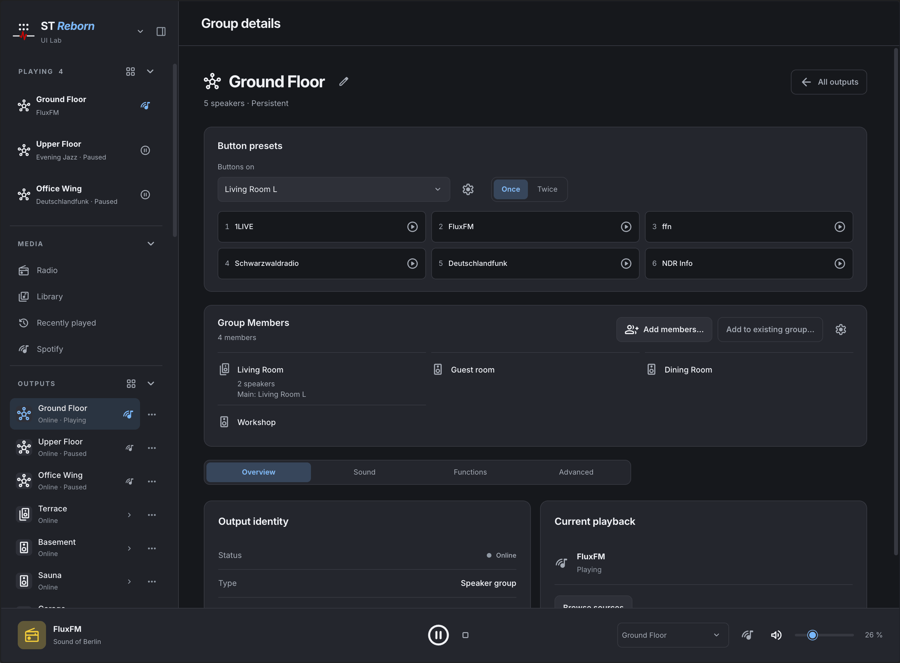

# ST Reborn — UI Lab

Interactive frontend for managing audio sources, devices, stereo pairs, groups and concurrent playback. Built with JavaScript modules, Vite, Tailwind CSS and daisyUI. Inter and Google Material Symbols are bundled locally.

The interface is organized around sources, group membership and reported device capabilities. ST Reborn is the first integration context; future adapters can extend it to other manufacturers and keep devices useful across a longer product lifecycle. [Product direction](docs/PRODUCT_DIRECTION.md).



## Run

```sh
npm install
npm run dev
```

Open the URL printed by Vite. Device and source data comes from JSON fixtures; actions update the local simulation. Local edits and appearance settings persist in browser `localStorage`. Choosing a scenario reloads its shipped fixture. Updated fixture revisions refresh older saved scenario data.

| Command | Purpose |
|---|---|
| `npm test` | Model, view and standalone integration tests |
| `npm run validate` | Validate scenario fixtures |
| `npm run build` | Build production assets into `dist/` |
| `python3 scripts/build-standalone.py` | Generate `ST_Reborn_UI_Lab_Standalone.html` for offline review |

Open the standalone HTML directly in a browser. For the module preview, serve the repository over HTTP and open `preview.html`.

Group membership brings multiroom, stereo pairs, temporary/saved groups and nested rooms into the same item details. [Concept and controls](docs/GROUP_MEMBERSHIP.md) explain who plays together and how playback and device functions relate.

## Scenarios

Select a scenario through the logo menu or Design Lab. Reset reloads its shipped fixture.

| Scenario | Data and behavior |
|---|---|
| Everyday use | Nine devices: individual speakers, a standalone stereo pair, a room group and two streams |
| Now Playing | Track, artist and album metadata, long titles, radio playlists and a running queue; simulate title changes in Design Lab |
| Nested groups | Whole home combines Downstairs and Upstairs; a separate terrace stream keeps playing |
| Problem of N · 50 devices | 50 physical devices, 38 playback targets, search and filters |
| Several streams | Four concurrent playback sessions |
| Maintenance & errors | Updating, offline and setup states |
| Device capabilities | Different key counts, gesture layers and device functions |
| First run | Empty inventory and speaker setup |
| Update notifications | Desktop and device update reports with a linked toast |

For group nesting, choose **Nested groups → Whole home → Details → Group Members**. [Concept and walkthrough](docs/GROUP_NESTING.md) explain shared playback, opening subgroups, separating and rejoining floors.

Library search selects titles across music servers and adds them to one or several saved queues. Queues persist with the scenario, support ordering and renaming, and can be used for playback or button presets. Collections show their source server. The player shows the current title when reported, with artist and album. Its playlist opens the station’s title history or the running queue; library queues support previous/next and reordering. Recently played retains received title information.

Music server settings accept server addresses and M3U, M3U8, PLS or XSPF playlist links. Add Spotify playlist URLs on the Spotify page. Links persist as typed playback and preset sources; the connected backend loads their contents.

Design Lab also provides navigation variants, appearance controls, JSON editing and export.

## Source

| Location | Responsibility |
|---|---|
| `src/app/` | Model, state, persistence and actions |
| `src/components/` | Navigation, player, dialogs and shared controls |
| `src/views/` | Media, outputs, item details, maintenance and Design Lab |
| `src/styles/` | Theme, layout and control styling |
| `src/assets/` | Local fonts and branding |
| `public/data/` | Scenarios, sources and UI configuration |
| `tests/` | Automated checks |
| `scripts/` | Asset generation, scenario validation and standalone build |

## Documentation

- [Group membership](docs/GROUP_MEMBERSHIP.md)
- [Interaction model](docs/INFORMATION_ARCHITECTURE.md)
- [Device capabilities](docs/DEVICE_CAPABILITIES.md)
- [View coverage](docs/VIEW_COVERAGE.md)
- [Backend integration plan](docs/WAILS_INTEGRATION.md)
- [Fonts](docs/FONTS.md), [icons](docs/MATERIAL_ICONS.md) and [branding](docs/BRANDING.md)

## Credits and license

UI concept and implementation: [Dr. D. Banner](https://github.com/DrDBanner).

Code and documentation: [Apache License 2.0](LICENSE). Copyright 2026 Dr. D. Banner and UI Lab contributors.

This product includes software developed as STR (SoundTouch Reborn) by Jens Roggenfelder. See [NOTICE](NOTICE) and [third-party notices](THIRD-PARTY-NOTICES.md) for bundled assets and styles. Full licence texts are also available in Help & info → Licenses and attribution, including in the offline standalone.
